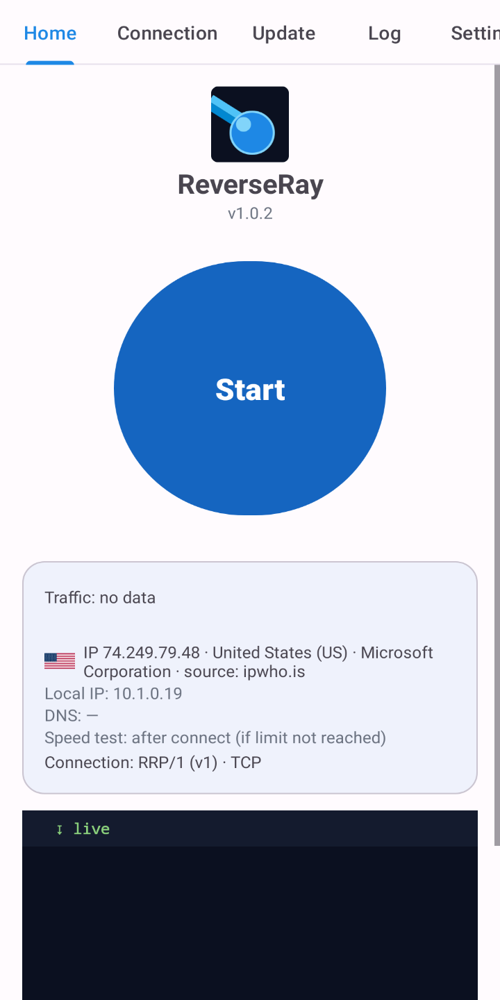
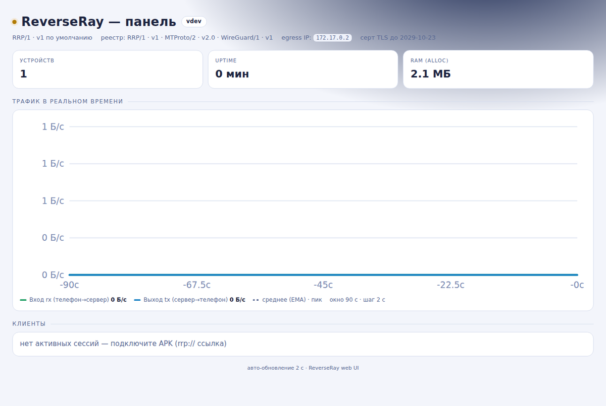
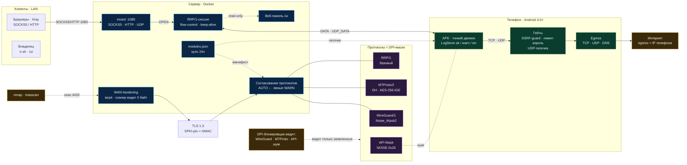
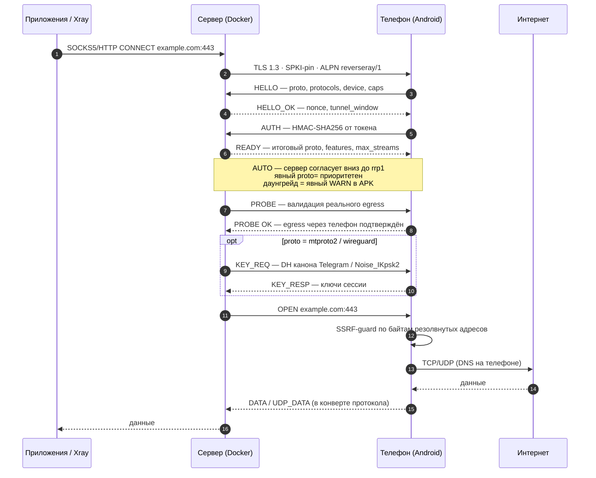

# ReverseRay

<h1 align="center">ReverseRay</h1>

<p align="center"><b>Личный прокси-сервер, выходящий через ваш Android-телефон.</b><br/>
Сервер выглядит как обычный SOCKS5/HTTP-прокси — сайты видят резидентный IP вашего устройства.</p>

<p align="center">
  <a href="https://github.com/stelgen/reverseray/releases"></a>
  <a href="https://github.com/stelgen/reverseray/actions/workflows/ci.yml"></a>
  <a href="LICENSE"></a>
  
  
  
</p>

---

## Возможности

- **Egress через телефон** — сервер инициирует исходящий трафик с резидентного IP; NAT/CGNAT не мешают
- **Протоколы = DPI-маски** — rrp1, WireGuard, MTProto/2: туннель выглядит для DPI как заявленный протокол
- **Мультипоточность** — N параллельных сессий через один порт; TCP-окна складываются
- **Модули без переустановки** — единый манифест `modules.json` для APK и сервера
- **Централизованное логирование** — ok зелёный / warn жёлтый / err красный на всех экранах
- **Транспорт TCP / WebSocket из UI** — вторая DPI-маска на уровне транспорта
- **WAN-hardening** — сканер не получает ни байта (tarpit + тишина)
- **Android 4.0+ (API 14)** — полный функционал без ограничений

<p align="center">
  <table>
    <tr>
      <td align="center" width="45%"><br/><sub><b>APK</b> · Android 4.0+</sub></td>
      <td align="center" width="55%"><br/><sub><b>Веб-панель</b> · /ui</sub></td>
    </tr>
  </table>
</p>

---

## Быстрый старт

**Сервер (одна команда):**

```bash
curl -fsSL https://raw.githubusercontent.com/stelgen/reverseray/main/deploy/rr.sh -o rr.sh
sudo bash rr.sh
```

**Телефон:** скачайте APK из [Releases](https://github.com/stelgen/reverseray/releases) → вставьте строку подключения → Старт.

**Проверка:**

```bash
curl --proxy socks5h://127.0.0.1:1080 https://ifconfig.me
# ответ — IP телефона
```

| Флаг rr.sh | Действие |
|---|---|
| *(нет)* | установка/обновление до последнего релиза |
| `RR_SESSIONS=3` | N параллельных сессий для агрегации скорости |
| `--reset` | обнулить состояние (токены/CA) |
| `--no-ui` | закрыть веб-панель в localhost |

---

## Как это работает



<details>
<summary><b>Sequence — хендшейк и согласование протокола</b></summary>



</details>

---

<details>
<summary><b>Состав проекта</b></summary>

| Компонент | Что это | Где |
|---|---|---|
| Сервер | Go (ноль сторонних зависимостей): SOCKS5/HTTP (TCP+UDP), RRP/1 + WebSocket, mtproto2, WAN-hardening, модули, метрики, TLS-PKI | [`server/`](server/) |
| Клиент | Kotlin (Android 4.0+): туннель (TCP/WS/mtproto2), модули, лимит-король, LogStore | [`android/`](android/) |
| Манифест | Один `modules.json` для APK и сервера | [`modules/`](modules/README.md) |
| Протокол | Спецификация RRP/1 + UDP + WS + mtproto2 + NOISE | [`docs/protocol.md`](docs/protocol.md) |
| Деплой | Автопилот `rr.sh` | [`deploy/rr.sh`](deploy/rr.sh) |
| CI | Тесты, приватность, модули, скриншоты, секреты | `.github/workflows/` |

</details>

## Принципы

| Принцип | Как исполняется |
|---|---|
| **Приватность** | Ни телеметрии, ни внешних хостов вне белого списка; privacy-audit — CI-гейт каждого PR |
| **Открытость** | «Ничего не прячем»: каждое действие видно в консоли / логах / метриках |
| **Защищённость** | TLS 1.3 + SPKI-pin, HMAC-токены, anti-SSRF, distroless без capabilities |
| **Совместимость** | Android 4.0+ (API 14); сервер — Linux amd64/arm64/armv7 |
| **Безопасность по умолчанию** | Автоподключение выключено; токены — только хэши |
| **Дисциплина железа** | Счётчики в RAM, запись раз в минуту; APK не тратит батарею |

<details>
<summary><b>Полный список возможностей</b></summary>

| Возможность | Суть |
|---|---|
| **RRP/1** | Мультиплексирование, flow-control (кредит ≤ буферу), keep-alive — [protocol.md](docs/protocol.md) |
| **wireguard** | Настоящий канон whitepaper: Noise_IKpsk2, ChaCha20-Poly1305, sliding-window 2048; PSK = SHA256(token); KAT Go↔Kotlin |
| **mtproto2** | DH-канон MTProto 2.0 (официальный dh_prime Telegram, AES-256-IGE); кросс-языковой KAT |
| **AUTO-протокол** | Ссылка без `proto=` = AUTO; сервер согласует вниз до rrp1; даунгрейд = явный WARN |
| **WAN-hardening** | Tarpit, ноль байт сканеру, per-IP лимиты |
| **Модульная система** | Один `modules.json` для APK и сервера; обновления без переустановки; мусор не применяется |
| **API Mask** | Фоновый шум как API бизнес-приложения; ноль внешних хостов; бюджет из манифеста |
| **UDP Relay** | Галочка рядом с API Mask; выкл → ноль дейтаграмм; переключается в живой сессии |
| **Централизованное логирование** | LogStore: кольцо 2000; роли ok/warn/error; экраны фильтруют свою часть |
| **Явные статусы согласования** | Даунгрейд = честный WARN, молчаливых нет |
| **Транспорт tcp/ws из UI** | Переключатель TCP/WebSocket; пишется в ссылку |
| **Авто-синхронизация модулей** | Обновил APK → modules.json подтягивается сам |
| **Мультипоточность** | N сессий через один порт; TCP-окна складываются |
| **Лимит трафика — король** | Исчерпан → ровно ноль байт; автоподключение ждёт сброса |
| **Пин CA — один канон** | SHA256(SPKI CA) у обеих сторон; ротация = один тап |
| **Диагностика подключения** | `auth failed` = честный статус; IP-локаут не маскируется |
| **Веб-панель /ui** | RT-график, телеметрия клиентов, камуфляж; vanilla JS |
| **Docker** | Distroless без шелла, governor в бинаре, cap_drop ALL, healthcheck |
| **Мультипоточность** | N сессий через один порт; агрегатный статус |

</details>

<details>
<summary><b>CI-роботы</b></summary>

| Робот | Что делает |
|---|---|
| `go` | gofmt / vet / test-race / coverage |
| `android` | Сборка + unit-тесты (Robolectric 21/31, evil-сервер, KAT, i18n-гейты) |
| `modules` | Канон-чек манифеста + парсеры обеих сторон |
| `privacy-audit` | Ни телеметрии, ни внешних хостов вне белого списка |
| `govulncheck` | Известные уязвимости stdlib/зависимостей |
| `gitleaks` | Секреты |
| `screenshot-apk` | JVM-рендер → `assets/brand/screenshot.png` |
| `screenshot-web` | Веб-панель из образа → `assets/brand/web.png` |
| `assets` | Детерминизм брендинга |
| `docker` | Сборка образа + healthcheck |
| `codeql` | Стат-анализ безопасности |
| `dependency-review` | PR-гейт зависимостей |

</details>

<details>
<summary><b>Если не подключается</b></summary>

| Шаг | Что делать |
|---|---|
| 1 | Вкладка «Лог»: весь журнал; кнопки «Копировать» и «Поделиться» |
| 2 | Порты **4433/tcp** и **1080/tcp+udp** должны быть открыты в файрволе |
| 3 | Строгий пин: ротация CA → APK покажет диалог «Сервер сменил сертификат» |
| 4 | `sudo bash rr.sh --reset` — чистое состояние за минуту |
| 5 | `ERROR 1: auth failed` — токен устарел: возьмите свежую строку из `rr.sh` |
| 6 | Сканеры в метриках `reverseray_hardening_*` — норма: порт молчит по дизайну |

</details>

---

## Интеграция с Xray

```json
{ "protocol": "socks", "settings": { "servers": [{ "address": "SERVER_IP", "port": 1080 }] } }
```

## Безопасность

TLS 1.3 + ALPN + SPKI-pin (анти-MITM), HMAC с одноразовым nonce, anti-SSRF,
WAN-hardening (tarpit), mtproto2 — канон MTProto 2.0, admin API — localhost,
distroless + governor. Полная модель — [`SECURITY.md`](SECURITY.md),
аудит — [`docs/security-audit-2026-10.md`](docs/security-audit-2026-10.md).

<details>
<summary><b>English</b></summary>

**ReverseRay** turns an Android device into the egress node of a personal proxy.
The server (Docker) exposes a standard SOCKS5/HTTP inbound, but all traffic
physically exits through your phone: the device initiates the TLS 1.3 tunnel
itself — no inbound ports or port forwarding required. Works behind NAT/CGNAT.

**Mission:** the ultimate self-hosted, free, private proxy — no VPN subscriptions;
your existing internet connection is enough. Legitimate personal use only.

### Quick start

```bash
curl -fsSL https://raw.githubusercontent.com/stelgen/reverseray/main/deploy/rr.sh -o rr.sh
sudo bash rr.sh
```

**Phone:** grab the APK from [Releases](https://github.com/stelgen/reverseray/releases),
paste the connection string, tap Start.

```bash
curl --proxy socks5h://127.0.0.1:1080 https://ifconfig.me
# returns the phone's IP
```

</details>

---

<p align="center">
  <a href="SECURITY.md">Security</a> ·
  <a href="docs/protocol.md">Protocol</a> ·
  <a href="modules/README.md">Modules</a> ·
  <a href="docs/WORKFLOW.md">Workflow</a> ·
  <a href="CHANGELOG.md">Changelog</a> ·
  <a href="https://stelgen.github.io/reverseray/">Landing</a>
</p>

## Лицензия

**BSD 2-Clause** — [LICENSE](LICENSE). Владелец — STELGEN.
Лицензия обязывает сохранять авторство в редистрибутивах.
Брендинг/документация — [CC-BY-4.0](https://creativecommons.org/licenses/by/4.0/).
